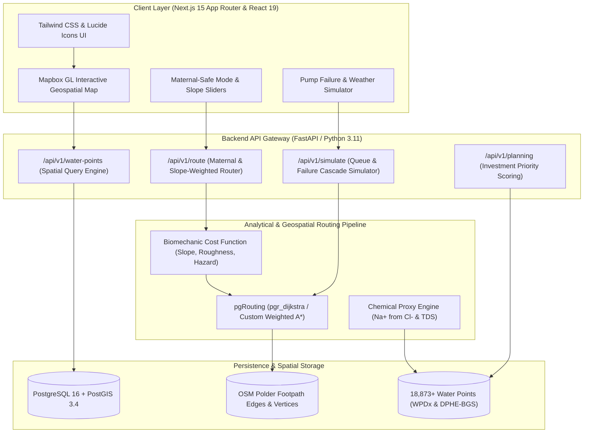

# JALDURBIN (জলদূরবীন)

**Coastal Water Access, Salinity Screening & Maternal-Safe Infrastructure Routing.**

JalDurbin is an AI and geospatial routing intelligence platform built to solve the dual crisis of **women's collection time poverty** and **salinity-induced maternal health risk** across 66,234 coastal households in Bangladesh (specifically Khulna and Satkhira). When rural residents, frontline community health workers (BRAC Shasthya Kormis), or water infrastructure planners evaluate water options, JalDurbin ingests 18,873+ mapped water points, real-world polder dyke footpaths, elevation gradients, tidal inundation schedules, and stoichiometric laboratory water-quality data, dynamically generating terrain-safe walking routes, simulated wait queues, and infrastructure investment priorities in seconds.

Built for the **Xylem Global Student Innovation Challenge (Track 3: Water Access Innovation)**.

[Try the live web app](https://jal-durbin.vercel.app/) · [Visit the public landing page](https://joldurbin.vercel.app/) · [GitHub Repository](https://github.com/TasinKazi/JalDurbin)

---

## At a glance

| Section | Description |
| :--- | :--- |
| **What** | Geospatial routing engine & infrastructure planning system integrating 18,873+ water points, OpenStreetMap polder dyke footpaths, dynamic pump queue surges, and maternal sodium screening across coastal Bangladesh. |
| **Why it's different** | Standard routing applications rely on Euclidean (Haversine) straight-line distance that dangerously routes women across unbridged 800m tidal rivers or steep mud dykes, ignoring water salinity. JalDurbin models real polder embankment networks, surface friction, slope penalties, and biochemical maternal health hazards ($>300\text{ mg/L}$ sodium). |
| **Who it's for** | Coastal village families, pregnant and postpartum women, community health workers (BRAC Shasthya Kormis), and water infrastructure NGOs / CSR investors (e.g., Xylem Watermark, Americares, DPHE). |
| **Maternal-Safe Mode** | Biomechanically and clinically tuned cost function that penalizes steep slopes ($>3\%$), eliminates slippery tidal clay, and strictly filters out drinking sources exceeding $300\text{ mg/L}$ sodium ($Na^+$) to prevent gestational hypertension and preeclampsia. |
| **Dynamic Queue & Decay** | Real-time simulation of pump failures, queue surge delays (15 to 45 mins), and seasonal monsoonal weather degradation (reducing walking speed from 5 km/h to 2 km/h). |
| **Infrastructure Planning** | Population buffer analysis and GIS deficit index ranking underserved wards (e.g., Gabura, Munshiganj, Padmapukur) to guide targeted CAPEX investment for new solar RO or PSF installations. |
| **Built with** | **Next.js 15 (App Router)** · **FastAPI (Python)** · **PostgreSQL + PostGIS + pgRouting** · **Mapbox GL** · **Tailwind CSS** · **Docker** · **TypeScript** |

---

## The problem

Across coastal Khulna and Satkhira in southwestern Bangladesh, over **66,234 households** live on the frontlines of a compounding drinking water crisis:

- **Women's Time Poverty:** In 80% of coastal households, women and girls bear the exclusive burden of fetching drinking water, spending between **1.5 to 6 hours daily** walking along remote polder dykes.
- **Seasonal Freshwater Scarcity:** Coastal families endure an average of **4.65 months per year** without reliable freshwater access, soaring up to **7.15 months** in upazilas like Paikgachha.
- **Maternal Health Hazard:** Seawater intrusion has caused chronic salinity in shallow aquifers. Medical literature documents that drinking water with $>300\text{ mg/L}$ sodium is associated with a **3.3x to 5.5x higher risk** of gestational hypertension and preeclampsia.
- **Financial & Infrastructure Burden:** When communal tube wells break down, families are forced to walk hours further or spend up to **20% of household income** purchasing water from commercial vendors.
- **The Blind Spot of Traditional GIS:** Generic map engines draw naive straight-line paths (Haversine circles) that point users across unbridged 800-meter tidal rivers, mudflats, and breach-prone embankments, while offering zero visibility into chemical potability or wait times.

JalDurbin solves this by grounding routing and planning in the physical delta realities of polder geography, water biochemistry, and maternal physiology.

---

## The solution

JalDurbin is an end-to-end geospatial intelligence system that unites communal water point databases, hydrochemical groundwater testing, and high-resolution OpenStreetMap footpath topologies into an interactive routing dashboard and investment prioritization toolkit.

### The Complete JalDurbin Workflow

```text
Village Resident / Frontline Health Worker sets coordinates (e.g. Munshiganj, Satkhira)
                                │
                                ▼
Data Ingestion & Verification (18,873+ WPDx points, DPHE-BGS chemistry, OSM paths)
                                │
                                ▼
Biochemical & Maternal Filtering (<300 mg/L Na+ ceiling, Stoichiometric Cl-/TDS proxy)
                                │
                                ▼
Embankment Graph Cost Optimization (Slope, Roughness, Mud Hazard, 20kg Return Burden)
                                │
                                ▼
Dynamic Simulation Engine (Pump Failure Rerouting, 15-45m Queue Surges, Rain Speeds)
                                │
                                ▼
Optimal Path & Infrastructure Assessment Generated (Interactive Mapbox GL visualizer)
```

---

## What makes it different

Unlike generic map applications or passive GIS viewers, JalDurbin is designed specifically for coastal delta vulnerabilities:

- **Maternal Sodium Screening (<300 mg/L):** Most routing engines only consider geographic distance. JalDurbin enforces medical literature ceilings ($300\text{ mg/L}$ sodium) to ensure pregnant women are never routed to brackish sources that trigger preeclampsia.
- **Embankment Footpath Graph vs. Naive Distance:** Naive routing calculates straight lines that cut through mangrove channels and rivers. JalDurbin snaps origins and water points to actual walkable polder dykes from OpenStreetMap/Geofabrik, penalizing mud and tidal inundation.
- **Dynamic Queue Times & Infrastructure Failure Simulation:** When a community solar RO or pond sand filter breaks down, JalDurbin models the cascade effect: neighboring facilities absorb displaced families, automatically surging queue wait times from 15 to 45 minutes.
- **Targeted Infrastructure Investment Scoring:** Empowers organizations like Xylem Watermark, Americares, and local authorities to query underserved wards (e.g., Gabura Ward 3), calculating population density within 100m buffers and estimating beneficiary impact for new facilities.

---

## Technical Architecture



### Architecture Breakdown

- **Frontend Application Layer:** Built with Next.js 15 (App Router), React 19, TypeScript, and Tailwind CSS. Mapbox GL handles vector tiles, polder paths, elevation gradients, and dynamic routing visualization.
- **High-Performance FastAPI Backend:** Asynchronous Python API gateway leveraging Pydantic v2 schemas and GeoAlchemy2 for spatial queries, connection pooling via `asyncpg`, and CORS-secured endpoints.
- **PostGIS & pgRouting Geospatial Core:** PostgreSQL 16 equipped with PostGIS 3.4 and pgRouting. Topologically formatted road and dyke edge tables enable dynamic edge-weighting queries based on real-time slope and surface parameters.
- **Biomechanical Edge-Cost Optimization:** Dynamically computes custom routing costs based on elevation slope ($\phi$), surface roughness ($S_e$), tidal inundation ($H_e$), and return carrying fatigue ($F(d)$).
- **Stoichiometric Inference Engine:** Where direct sodium laboratory tests are missing, JalDurbin approximates values using peer-reviewed proxies: $\text{Na}^+ \approx 0.55 \times \text{Cl}^-$ or $\text{Na}^+ \approx 0.31 \times \text{TDS}$.

---

## Maternal-Safe Routing Mathematical Formulation

Standard shortest-path routing minimizes metric length ($D = \sum L_e$). For pregnant or postpartum women carrying 15–20 kg water vessels in coastal deltas, distance is secondary to terrain gradient, surface traction, and tidal hazards.

### Edge Cost Function

$$C(e) = L_e \times \Big( 1 + w_{\text{slope}} \cdot \phi(\text{slope}_e) + w_{\text{surface}} \cdot S_e + w_{\text{hazard}} \cdot H_e + w_{\text{fatigue}} \cdot F(d) \Big)$$

- **Slope Penalty $\phi(\text{slope}_e)$:**
  - $\le 3\%$: $\phi = 0.0$ (Gentle terrain)
  - $3\% < \text{slope} \le 6\%$: $\phi = 1.5 \times (\text{slope} - 0.03)$
  - $6\% < \text{slope} \le 8\%$: $\phi = 4.0 \times (\text{slope} - 0.03)$
  - $> 8\%$: Edge cost set to $\infty$ (Strict cutoff: bypass steep embankments or mud levees)
- **Surface Roughness Index ($S_e$):**
  - Paved / Brick soling: $S_e = 0.0$
  - Compacted gravel: $S_e = 0.3$
  - Unpaved dirt: $S_e = 1.0$
  - Tidal mud / slippery clay: $S_e = 4.0$
- **Tidal & Inundation Hazard ($H_e$):**
  - Submerged during current/forecast high tide: $H_e = \infty$
  - Low-lying berm without lighting/shade: $H_e = 1.5$
- **Fatigue Return Factor ($F(d)$):**
  - Return trip with a 15–20 kg load penalizes distance non-linearly:
    $$F(d) = \left(\frac{d}{1000\text{ m}}\right)^{1.4}$$

---

## Datasets & Open Data Foundation

JalDurbin integrates public datasets to map water points, assess quality, and compute walkable routes across southwestern Bangladesh:

| Dataset | Provider | Records / Scope | Role in JalDurbin |
| :--- | :--- | :--- | :--- |
| **[Water Point Data Exchange (WPDx)](https://data.humdata.org/dataset/wpdx_bgd)** | Global Water Challenge | 18,873+ mapped points across Bangladesh | Community tube wells, pond sand filters, solar RO plants, and operational statuses |
| **[National Hydrochemical Survey](https://www.bgs.ac.uk/groundwater/download/dphe-bgs-national-hydrochemical-survey/)** | British Geological Survey (BGS) & DPHE | Laboratory hydrochemical records | Ground-truth measurements of sodium ($Na^+$), chloride ($Cl^-$), arsenic, and TDS |
| **[Multiple Indicator Cluster Survey (MICS)](https://www.unicef.org/bangladesh/en/media/12191/file/MICS%20Preliminary%20findings%202025.pdf.pdf)** | UNICEF Bangladesh | Household survey observations | Documented collection times, premises water availability, and community water burdens |
| **[Coastal Salinity Mapping](https://zenodo.org/records/14560019)** | Zenodo Open Science | Regional salinity geospatial rasters | Spatial variations in groundwater salinity and dry-season intrusion zones |
| **[Historical Climate Data](https://climateknowledgeportal.worldbank.org/country/bangladesh/climate-data-historical)** | World Bank Climate Knowledge Portal | Sub-district precipitation & dry periods | Monsoon vs. dry-season water availability and monsoonal walking speed adjustments |
| **[Bangladesh OSM Extracts](https://download.geofabrik.de/asia/bangladesh.html)** | Geofabrik / OpenStreetMap | Road, path, dyke, canal & river vectors | Topology for polder embankment routing, footpaths, bridges, and waterways |

---

## Real-World Case Study Context

JalDurbin aligns with humanitarian WASH initiatives in coastal Bangladesh, such as the documented partnership between **Xylem Watermark** and **Americares** ([Water Action Hub Project #2325](https://wateractionhub.org/projects/2325/)):
- **174 Healthcare Facilities** supported through clean water, sanitation, and hygiene upgrades.
- **2.4 Million People Reached Annually** across disaster-vulnerable coastal communities.

JalDurbin provides the missing geographic and maternal intelligence layer to determine where community water points should be deployed next to deliver the greatest daily relief to underserved coastal families.

---

## Develop

### Prerequisites
- Docker & Docker Compose (recommended)
- Node.js 18+ & Python 3.11+ (for local manual development)
- PostgreSQL 16 with PostGIS & pgRouting extensions

### Quickstart with Docker Compose

```bash
# 1. Clone the repository & navigate to workspace
git clone https://github.com/TasinKazi/JalDurbin.git
cd JalDurbin

# 2. Configure environment variables
cp .env.example .env

# 3. Start PostgreSQL/PostGIS, FastAPI backend, and Next.js frontend
docker compose up -d

# 4. Ingest water points and road network
docker compose exec backend python scripts/ingest_water_points.py
```

### Manual Development Setup

#### Backend (FastAPI + PostGIS)
```bash
cd backend
python -m venv venv && source venv/bin/activate
pip install -r requirements.txt
uvicorn app.main:app --host 0.0.0.0 --port 8000 --reload
```

#### Frontend (Next.js 15 + Mapbox GL)
```bash
cd frontend
npm install
npm run dev
# Running on http://localhost:3000
```

---

## License

This project is licensed under the Apache 2.0 License - see the [LICENSE](LICENSE) file for details.
